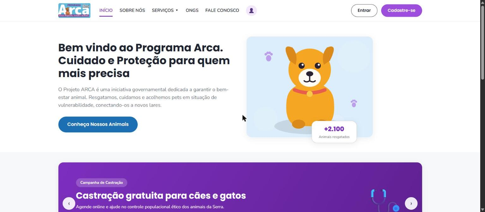
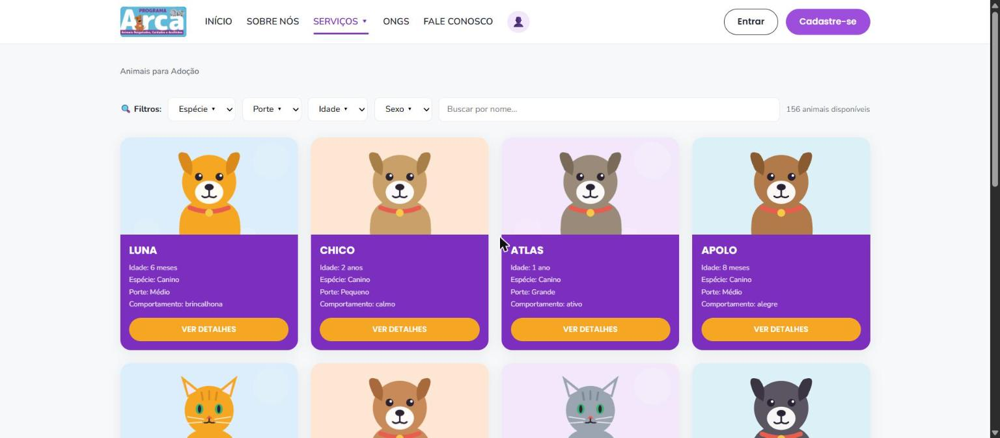
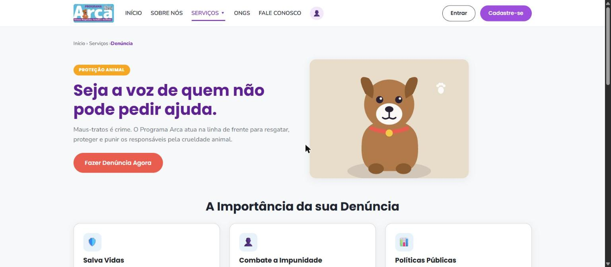
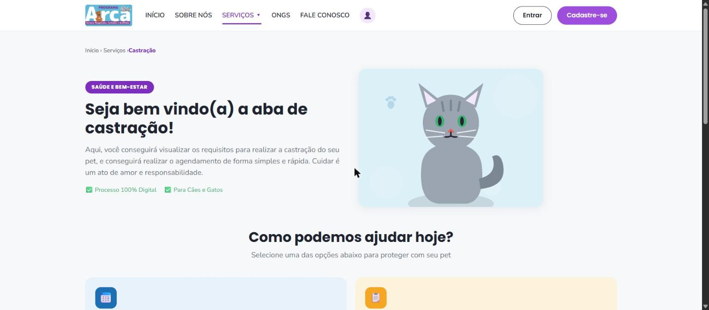

# Programa ARCA — Animais Resgatados, Cuidados e Acolhidos

Plataforma web para o programa de bem-estar animal da **Prefeitura Municipal da Serra/ES**, desenvolvida como Projeto Integrador do curso de Engenharia de Software da **Universidade Vila Velha (UVV)**, em 2026.

O projeto foi **selecionado entre os da turma para apresentação à Prefeitura da Serra**.

**[Acessar a aplicação](https://thayrinacs.github.io/programa-ARCA/)** · **[Documentação completa (PDF)](docs/Documentacao_Projeto_Arca.pdf)**



---

## Objetivo

Oferecer uma plataforma digital única que conecte a população da Serra aos serviços municipais de proteção animal, centralizando três frentes principais: **agendamento de castração gratuita**, **adoção responsável** e **registro de denúncias de maus-tratos**. A proposta reduz a burocracia no acesso a esses serviços e dá transparência ao andamento de cada solicitação por meio de protocolos e status.

## Funcionalidades

- **Adoção** — catálogo de animais com filtros, página de detalhes e formulário de adoção em múltiplas etapas (dados pessoais, moradia, rotina e termo de responsabilidade)
- **Castração** — critérios de elegibilidade, requisitos, orientações pré e pós-operatórias e agendamento online com revisão e confirmação
- **Denúncia** — registro de maus-tratos com opção anônima, envio de evidências, localização da ocorrência, geração de protocolo e acompanhamento de status
- **Cadastro e perfil** — conta do cidadão com painel de pets cadastrados e processos em andamento
- **Institucional** — página inicial, sobre o programa, ONGs parceiras, notícias, FAQ e fale conosco

| Adoção | Denúncia | Castração |
|---|---|---|
|  |  |  |

## Projeto interdisciplinar

O desenvolvimento integrou três disciplinas, mantendo coerência entre o que foi pesquisado, projetado, modelado e implementado.

### UX/UI Design
- Pesquisa e organização: moodboard, card sorting e user flows (Figma e Miro)
- Design system e style guide: paleta de cores, tipografia, iconografia, grids e componentes
- Protótipo navegável no Figma cobrindo todos os fluxos da solução
- Testes de usabilidade

### Banco de Dados (PostgreSQL)
- Modelo conceitual (BRModelo) e modelo físico (drawSQL)
- Seis entidades: `cidadao`, `administrador`, `animal`, `solicitacao_adocao`, `solicitacao_castracao` e `denuncia`, com chaves estrangeiras e restrições de integridade (`CHECK` e `UNIQUE`)
- [`database/01_ddl.sql`](database/01_ddl.sql) — criação do esquema
- [`database/03_dql.sql`](database/03_dql.sql) — consultas para relatórios gerenciais (adoções por mês, demanda de castração, média mensal de adoções, entre outras)

### Construção de Aplicações Web
- Single Page Application em HTML5, CSS3 e JavaScript, com Bootstrap 5.3
- Navegação entre telas sem recarregamento, validações e máscaras de formulário (CPF, telefone)
- Layout responsivo com variáveis CSS e media queries
- Publicação no GitHub Pages

## Tecnologias


## Estrutura

```
programa-ARCA/
├── index.html        estrutura e conteúdo de todas as telas
├── css/style.css     identidade visual e responsividade
├── js/script.js      navegação (SPA), validações e interações
├── database/         scripts SQL (PostgreSQL)
└── docs/             documentação e imagens
```

## Melhorias futuras

- Back-end e banco de dados integrados, tornando cadastro, login e formulários persistentes
- Painel administrativo para gestão de adoções, castrações e denúncias
- Notificações por e-mail ou WhatsApp sobre o andamento dos protocolos
- Ampliação dos recursos de acessibilidade

> A aplicação é estática: o envio dos formulários é simulado para fins de demonstração da experiência.

## Equipe

Daniel Furtado · Kaike Alves · Melissa Monteiro · Rhayanne Borges · Thayrina Stange
